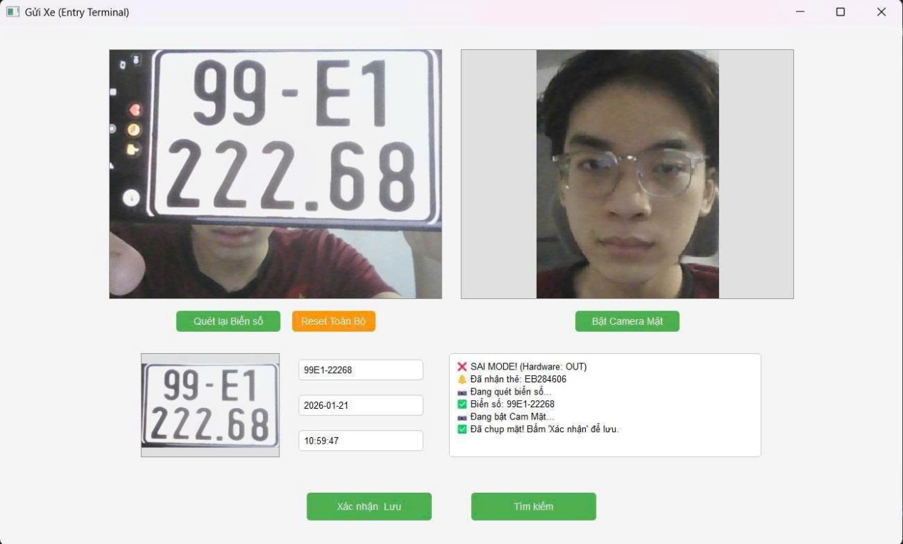
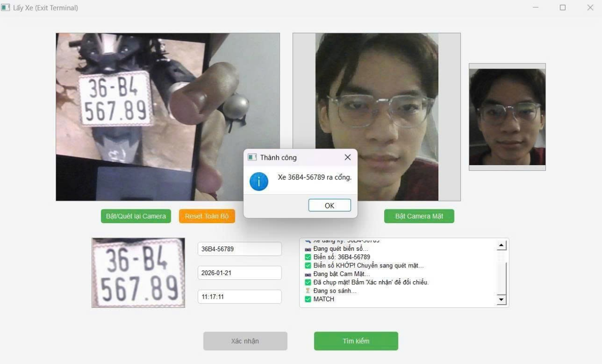
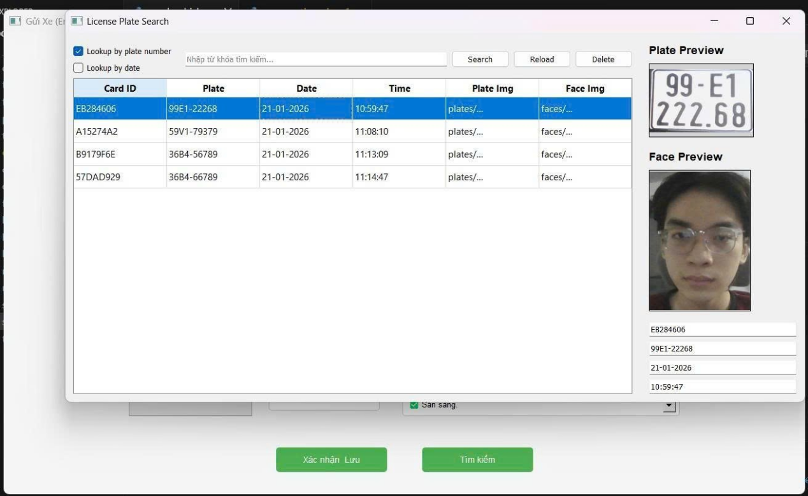
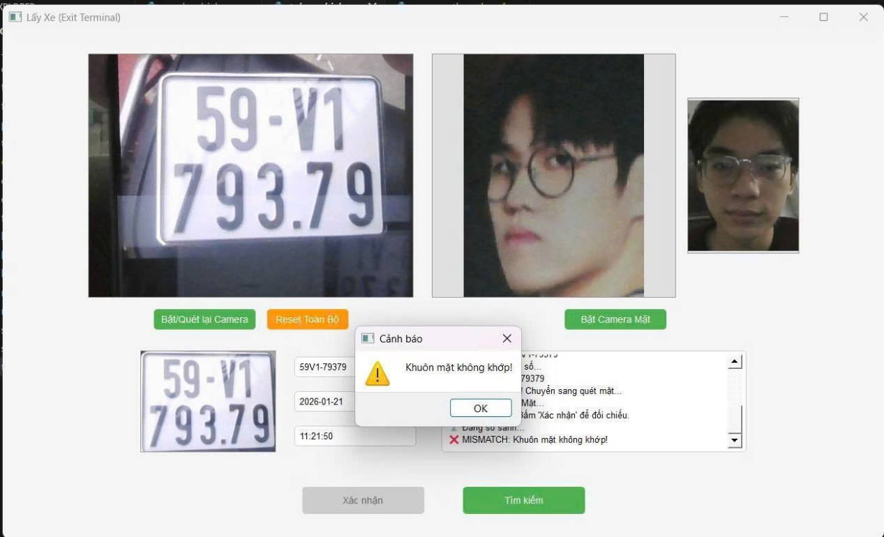
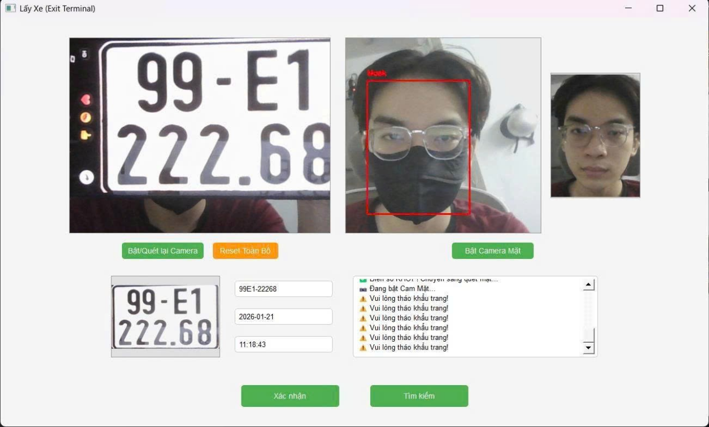
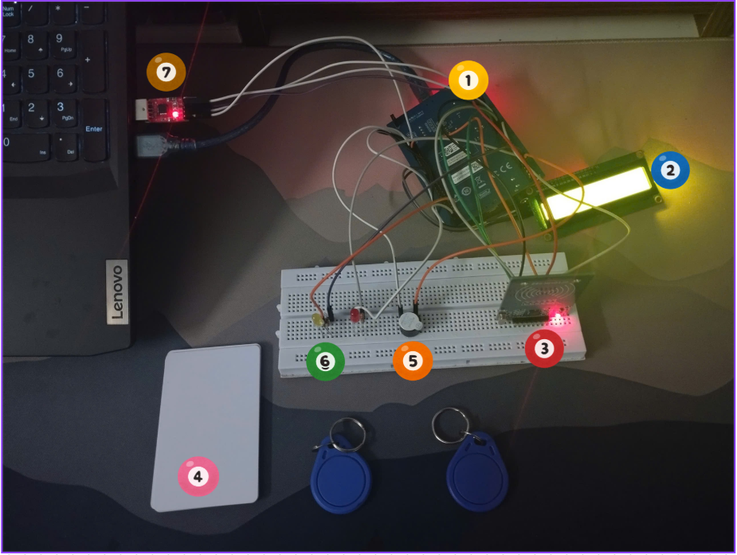
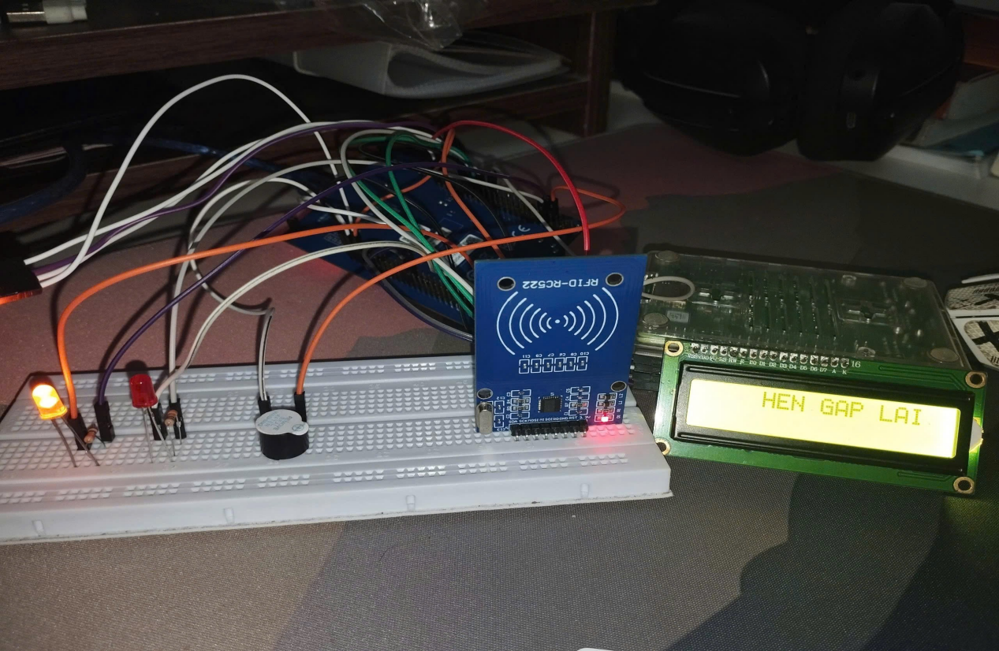
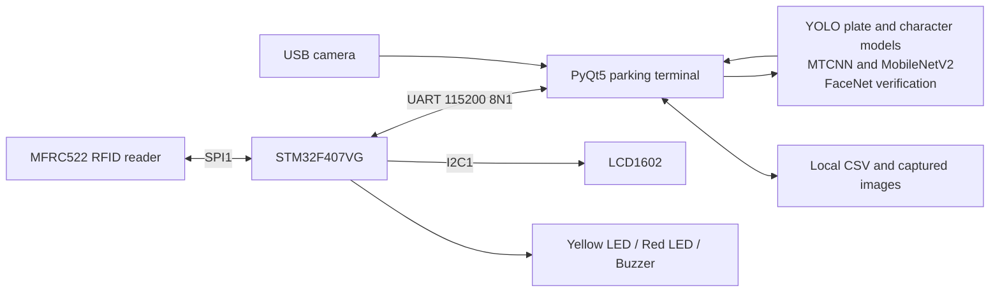

# Smart Parking — Computer Vision & STM32

A desktop parking management prototype combining **RFID identification, license plate recognition, and face verification** with an **STM32F407** hardware controller.

Developed for Project 2 (*Đồ án 2*) at HCMUTE. Python runs the vision models and stores parking records; the STM32 reads RFID cards and drives the LCD, status LEDs, and buzzer.



## Features

- **Check-in:** scan an RFID card, recognize a plate, capture an unmasked face, and save the record with images.
- **Check-out:** verify the card, plate, and face against the saved entry before confirming departure.
- **Plate recognition:** a YOLO detector locates the plate; a second YOLO model recognizes its characters, with ordering and correction for Vietnamese plate layouts.
- **Face verification:** InceptionResnetV1 pretrained on VGGFace2 produces 512-dimensional embeddings, compared using Euclidean distance.
- **Mask detection:** MTCNN locates faces and MobileNetV2 classifies mask/no-mask. Capture requires one unmasked face held for two seconds.
- **Desktop interface:** PyQt5 camera workers, image previews, reset/re-scan controls, and record search/deletion.
- **Hardware feedback:** LCD1602 messages, a yellow LED for success, and a red LED/buzzer for errors, over a bidirectional UART connection.

This implementation uses RFID **UIDs as lookup keys**. Parking information and images are stored on the PC; the application does not write vehicle data into RFID card sectors. Successful authorization is demonstrated with an LED/LCD, rather than a motorized barrier.

## Demonstration results

The following images are extracted directly from the original [project report](baocaodoan.docx), Figures 4.2 and 5.7–5.14. They document the original prototype demonstration; they are not screenshots or benchmark results from the later maintenance changes.

| Successful check-out | Stored parking records |
| --- | --- |
|  |  |

| Face mismatch warning | Mask warning |
| --- | --- |
|  |  |

| Hardware prototype | Check-out feedback |
| --- | --- |
|  |  |

See [image provenance](docs/images/README.md) for the original figure numbers. The report contains the theory, design, and experimental discussion. No new quantitative accuracy claim is made by this repository.

## System architecture



**Check-in:** UID → verify IN mode and unused card → plate recognition → unmasked face capture → operator confirmation → save CSV/images → success feedback.

**Check-out:** UID → reload current records and verify OUT mode → match plate → capture face → compare with the entry image → operator confirmation → remove the active record/images → success feedback. A mismatch keeps the vehicle record and triggers an error.

The CSV represents **vehicles currently parked**, not a permanent entry/exit audit log. Images are deleted when a vehicle successfully checks out or an operator deletes its record.

## Repository structure

```text
SmartParking/
├── send_vehicle.py                 # Check-in terminal
├── take_vehicle.py                 # Check-out terminal
├── app_config.py                   # Paths, camera and UART configuration
├── camera_thread.py                # Camera workers and capture flow
├── license_plate_module.py         # Plate detection and character recognition
├── mask_detector_module.py         # Face location and mask classification
├── face_matcher.py                 # Face embeddings and comparison
├── parking_store.py                # Atomic CSV updates and image cleanup
├── serial_protocol.py              # UART framing and event validation
├── search_window.py                # Search, preview and delete records
├── license_plate_detector.pt       # Plate detector weights
├── character_detector.pt           # Character detector weights
├── license_plate.ipynb             # Plate recognition demonstration
├── face_mask_detection/            # Mask model, training notebook and plots
├── STM32CubeIDE/workspace_doan2/
│   └── STMProject/                 # Canonical firmware, CubeIDE config and drivers
├── docs/                          # Wiring/protocol guide and report images
├── tests/                         # Persistence, protocol and desktop-flow tests
├── tools/                         # Firmware build and model checks
├── baocaodoan.docx                 # Original Vietnamese project report
└── Schematic_…2026-01-21.pdf        # Original hardware schematic
```

Virtual environments, experimental STM32 workspaces, Eclipse workspace metadata, firmware build outputs, live CSV records, and captured face/plate images are excluded from Git.

## Hardware

| Component | Purpose |
| --- | --- |
| STM32F407G-DISC1 / STM32F407VGT6 | RFID, UART, LCD and output control |
| MFRC522 | Read 13.56 MHz RFID card UIDs |
| LCD1602 + PCF8574 I2C adapter | Mode and processing/result messages |
| USB–UART adapter | PC ↔ STM32 communication |
| USB camera | Sequential plate and face capture |
| Yellow/red LEDs, resistors and active buzzer | Success/error indication |

The firmware uses SPI1, I2C1 (LCD address `0x27`), and USART2 at **115200 baud, 8 data bits, no parity, 1 stop bit**. The complete pin map and UART commands are documented in [docs/HARDWARE.md](docs/HARDWARE.md); the [original schematic](Schematic_Sơ-đồ-khối_2026-01-21.pdf) is included for reference.

## Installation

The maintained dependency set targets **Windows x64 with Python 3.10 or 3.11**. Python 3.14 is not supported by these pinned model dependencies. CPU inference is supported; native Windows TensorFlow 2.15 uses the CPU.

```powershell
git clone https://github.com/MinhNhan0508/SmartParking.git
cd SmartParking

py -3.10 -m venv .venv
.\.venv\Scripts\python.exe -m pip install --upgrade pip
.\.venv\Scripts\python.exe -m pip install -r requirements.txt
```

Use `py -3.11` instead if Python 3.11 is installed. Calling the virtual environment's Python directly avoids needing to change PowerShell's script execution policy.

The repository contains both YOLO weight files and `face_mask_detection/mask_detector.h5`. **FaceNet's VGGFace2 weights download automatically on first use**, so an internet connection is required once; later runs use the local Torch cache. MTCNN weights are included in `facenet-pytorch`.

For notebook development, also install:

```powershell
.\.venv\Scripts\python.exe -m pip install -r requirements-dev.txt
```

## Firmware setup

1. Open STM32CubeIDE and select a workspace, for example `STM32CubeIDE/workspace_doan2`.
2. Choose **File → Import → General → Existing Projects into Workspace**, select `STM32CubeIDE/workspace_doan2/STMProject`, and import **STMProject** without copying it elsewhere.
3. Build the project, connect the STM32's ST-LINK USB port, and flash/debug the firmware.
4. Connect the USB–UART adapter to USART2 and use its COM port in the Python application. ST-LINK programming and the external UART connection are separate connections in this prototype.

The `.ioc` configuration and firmware clock are aligned to an **8 MHz HSE and 168 MHz system clock**. Required HAL/CMSIS sources are included; the build configuration uses repository-relative include paths.

A command-line build is also available with `arm-none-eabi-gcc` on `PATH`:

```powershell
python tools/build_firmware.py
# Or supply --compiler "C:\path\to\arm-none-eabi-gcc.exe"
```

The script can also locate a standard STM32CubeIDE toolchain under `C:\ST`. Build products are written to `.tools/firmware-build/` and are excluded from Git.

## Run the application

Find the adapter's COM port in Windows Device Manager and set the configuration in the same terminal used to launch the application:

```powershell
$env:PARKING_SERIAL_PORT = "COM11"
$env:PARKING_CAMERA_ID = "0"
# Optional; must match the flashed firmware:
$env:PARKING_BAUD_RATE = "115200"
```

Launch **one terminal application at a time** when using the shared board, COM port and camera:

```powershell
# Check-in; leave the board in IN mode:
.\.venv\Scripts\python.exe send_vehicle.py

# Close check-in before launching check-out, then select OUT on the board:
.\.venv\Scripts\python.exe take_vehicle.py
```

Press the Discovery board's **PA0 User button** while idle to switch IN/OUT. The firmware starts in IN mode; the app and board modes must agree. Within a transaction, scan the card first, then the plate, then the face, and finally press **Xác nhận**. **Reset Toàn Bộ** cancels the current transaction.

Paths are resolved relative to the repository, so the launch directory does not determine where models or data are found. `data.csv`, `plates/`, and `faces/` are created as needed; [data.example.csv](data.example.csv) documents the CSV header.

## Validation

```powershell
# Tests use a fake serial port and temporary files; no board/camera is needed:
.\.venv\Scripts\python.exe -m unittest discover -s tests -v

# Real model loading and synthetic inference:
.\.venv\Scripts\python.exe tools/check_models.py
.\.venv\Scripts\python.exe tools/check_models.py --face
```

The maintenance checks cover partial/batched UART messages, invalid event rejection, duplicate records, failed disk replacement, fresh data on check-out, persistence before success feedback, and reset timers. Synthetic inference checks model compatibility, not recognition accuracy. A hardware-in-the-loop retest is still required after flashing; see [docs/VALIDATION.md](docs/VALIDATION.md).

## Notebooks and training

- [license_plate.ipynb](license_plate.ipynb) demonstrates the same recognition pipeline used by the desktop application. Set `PARKING_TEST_IMAGE` to your own image, or use the included report screenshot example.
- [training_mask_detector.ipynb](face_mask_detection/training_mask_detector.ipynb) trains the MobileNetV2 mask classifier. Supply a dataset containing `with_mask/` and `without_mask/` folders via `MASK_DATASET_DIR`. Training data is not included.
- [Accuracy](face_mask_detection/accuracy_plot.png) and [loss](face_mask_detection/loss_plot.png) plots are retained from the original training run. Notebook outputs are cleared to avoid shipping large, stale execution results.

## Known limitations

- This is a local academic prototype for one shared terminal at a time; CSV storage does not support concurrent parking lanes.
- Plate recognition depends on lighting, angle and image quality. The face-distance threshold defaults to `0.7` and needs calibration on representative data, especially after changing preprocessing or models.
- Face verification has no liveness/anti-spoofing check. RFID UIDs serve as identifiers rather than cryptographic authentication.
- There is no physical barrier motor, persistent exit history, user-account system, or production deployment in this source.
- Original report screenshots describe the earlier demonstration; maintenance changes have automated tests and a firmware build, but have not been revalidated on the physical prototype.

## Authors and acknowledgements

- **Lê Minh Nhân** — 22119206
- **Hồ Sỹ Nguyên** — 22119203
- **Supervisor:** ThS. Đậu Trọng Hiển
- Faculty of Electrical and Electronics Engineering, HCMUTE — Project 2, January 2026.

Thanks to STMicroelectronics, Arm CMSIS, Ultralytics, facenet-pytorch, TensorFlow/Keras, OpenCV and PyQt. Third-party driver license files are retained in the firmware tree. See [docs/THIRD_PARTY.md](docs/THIRD_PARTY.md) for component and model attribution. No project-wide license has been selected for the original project materials.
