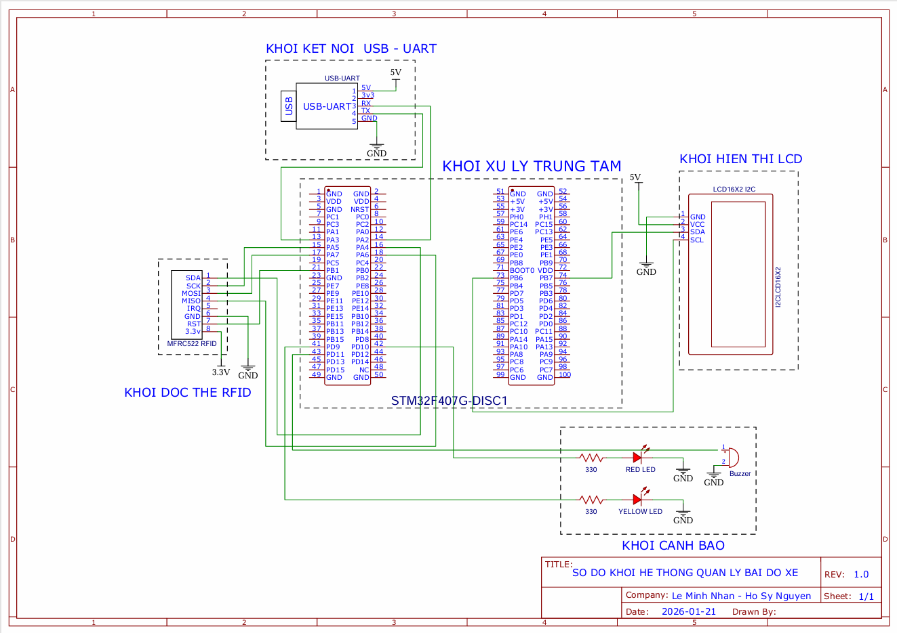

# Hardware and UART reference

Canonical firmware: `STM32CubeIDE/workspace_doan2/STMProject`.

## Pin map

| Peripheral signal | STM32F407 pin |
| --- | --- |
| RC522 SDA / CS | PA4 |
| RC522 SCK | PA5 |
| RC522 MISO | PA6 |
| RC522 MOSI | PA7 |
| RC522 RST | PB1 |
| LCD I2C SCL | PB6 |
| LCD I2C SDA | PB7 |
| USART2 TX → adapter RX | PA2 |
| USART2 RX ← adapter TX | PA3 |
| Yellow success LED | PD9 |
| Red error LED | PD10 |
| Active buzzer control | PD11 |
| User button / toggle IN–OUT | PA0 |

Use a shared ground. The RC522 uses the 3.3 V rail. Consult the included schematic for power, resistors and output wiring. The firmware deselects the Discovery board's accelerometer on PE3 to avoid contention on SPI1. The LCD's 7-bit I2C address is `0x27` (`0x27 << 1` in the HAL call).



The above is the original report schematic. The pin definitions in `Core/Inc/main.h`, the peripheral source files, and `STMProject.ioc` describe the maintained firmware configuration.

## UART protocol

**115200 baud, 8N1**, no hardware flow control. Each message is ASCII terminated by `\n`; the receiver also accepts `\r\n`. Supported card events contain four UID bytes (eight hexadecimal characters).

### STM32 → PC

```text
UID:AABBCCDD|MODE:IN
UID:AABBCCDD|MODE:OUT
MODE:IN
MODE:OUT
```

The desktop terminal starts a transaction only from a complete `UID:...|MODE:...` message. Standalone mode announcements do not change which desktop script is running. Select the matching app and board mode before scanning.

### PC → STM32

| Command | Effect |
| --- | --- |
| `CMD:SCAN_PLATE` | Start the transaction and display the plate scanning status |
| `CMD:PLATE:59A-12345` | Store/display plate text, limited to 16 LCD characters |
| `CMD:SCAN_FACE` | Display face scanning status with the plate |
| `CMD:MASK_WARN` | Ask the driver to remove the mask |
| `CMD:FACE_OK` | Indicate that a face image was captured |
| `CMD:SUCCESS` | Yellow LED and welcome/goodbye message for three seconds |
| `CMD:ERROR:message` | Red LED for three seconds, buzzer for 0.5 seconds, error text |
| `CMD:RESET` | Clear transaction state and return to idle |

`FACE_OK` means capture completed. The final identity check is performed by the PC before it sends `SUCCESS` in OUT mode.

The interrupt handler queues completed commands instead of letting the next serial line overwrite the current one. The FIFO holds seven pending commands, each up to 127 characters; overlong lines are discarded. Queue overflow emits `WARN:UART_QUEUE_FULL`. The protocol has no acknowledgement/retry mechanism, so inspect the connection and reset the transaction if a command is lost.

The main loop uses nonblocking timers for status signals. Holding the button toggles mode only once, and mode changes are ignored during an active transaction or result indication.

## Recovering from an interrupted transaction

Use **Reset Toàn Bộ** to stop capture and send `CMD:RESET`. If the PC was disconnected while a transaction was active, reconnect/start the terminal and press Reset, or reset the board. Close the other terminal before reusing the same COM port/camera.
